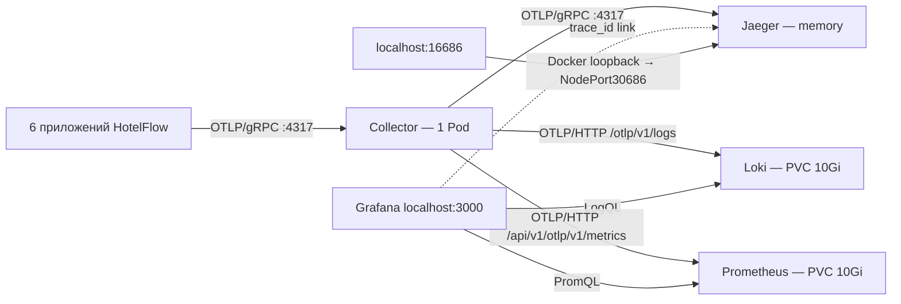

# Наблюдаемость HotelFlow: трейсы, логи и метрики

Шесть приложений отправляют трейсы, структурированные логи и метрики глобального Prometheus registry по OTLP/gRPC в один OpenTelemetry Collector. Он направляет сигналы в Jaeger memory, Loki и Prometheus. Grafana показывает метрики, логи и ссылки на трейсы. JSON stdout сохраняется; повторного сбора stdout нет. Сбор с PostgreSQL, Kafka, etcd и других хранилищ не включен.



## Запуск и постоянные адреса

В `hotel.yaml` включено:

```yaml
observability:
  enabled: true
  stage: metrics
```

`hotelctl up` разворачивает `deploy/observability/metrics` в namespace `hotelflow` и ожидает готовности Collector/Jaeger/Loki/Grafana/Prometheus. Этап `traces` также поддерживается: он оставляет только экспорт трейсов. Команда `up` не выполняет smoke или бизнес-запросы.

- Jaeger: [http://localhost:16686](http://localhost:16686), постоянный NodePort 30686.
- Grafana: [http://localhost:3000](http://localhost:3000), постоянный NodePort30300, вход `admin`. Пароль хранится в Secret `hotelflow/grafana-admin`.
- Loki: `loki.hotelflow.svc.cluster.local:3100`, только внутри кластера; запросы пользователя идут через Grafana.
- Collector: `otel-collector.hotelflow.svc.cluster.local:4317` для приложений; 4318 — OTLP/HTTP внутри кластера. На Mac эти порты не опубликованы.

Оба UI binding добавляются на первом этапе. Текущий Docker runtime обновляет binding через пересоздание контейнера k3s с тем же именованным томом; при первой установке наблюдаемости будет краткий перерыв работы стенда. До остановки проверяются новые host-порты; для работающего кластера проверяются занятые NodePort. Не выполнять `destroy` или `reset` для включения трейсов. Структура сохраненного Runtime не меняется.

```sh
make build
./bin/hotelctl up
./bin/hotelctl access
./bin/hotelctl status
./bin/hotelctl logs otel-collector -f
./bin/hotelctl logs jaeger -f
```

В `components`, `status`, `start/stop/restart/logs` на этапе `logs` доступны `otel-collector`, `jaeger`, `loki`, `grafana`. На этапе `traces` Grafana остается резервом порта без активного workload. `hotelctl deploy <service>` также использует актуальные observability manifests. `observability.enabled: false` отключает OTLP export при последующем deploy приложений; это не удаляет ранее созданные Kubernetes ресурсы.

## Конфигурация и память

- Collector contrib `0.163.2`, Jaeger `2.22.0`; images закреплены digest. Конфиги проверены командами `validate` в этих images. В первоначальном research использовался Collector0.163.0, но его tag отсутствовал в проверенных DockerHub/GHCR registries; применен официальный patch0.163.2 той же ветки.
- Один Collector Deployment с `replicas: 1`, `strategy: Recreate`; обновление дает короткую паузу приема, без второй реплики при штатном rollout.
- Collector: `memory_limiter → batch → otlp_grpc/jaeger`, ограниченная RAM-очередь 10000 spans и retry до60s. Это не гарантия доставки: переполнение/timeout/restart могут потерять буфер.
- Jaeger хранит до5000 traces в RAM, без PVC. Это предел количества, не TTL и не точный memory bound. Рестарт/остановка Jaeger удаляет всю историю; поздно доставленные события могут иметь лишь часть старой трассы.
- Только у контейнера Jaeger задан `OTEL_TRACES_SAMPLER=always_off`: он отключает [самотрассировку Query API](https://www.jaegertracing.io/docs/2.22/operations/monitoring/#traces), чтобы в списке сервисов были приложения HotelFlow. Прием прикладных OTLP traces, логи и health probes сохраняются; у приложений остается `parentbased_always_on`. Изменение env применяется при следующем rollout, который очистит Jaeger memory.
- У обоих Pod requests100m/128Mi, limits1CPU/512Mi, grace30s. Конфиги ConfigMap имеют hash suffix и при изменении запускают новый rollout.
- Probes: Collector13133 `/`, Jaeger13133 `/status`. Успешная probe проверяет процесс, а не доставку конкретного trace.
- Внутренний диагностический endpoint Collector8888 не является потоком прикладных метрик; его автоматический сбор не включен.

## Инициализация telemetry и spans в приложениях

`internal/pkg/telemetry` управляет жизненным циклом наблюдаемости. Реализованы tracing и logs на OpenTelemetry Go SDK **1.47.0** с официальными `otelhttp`/`otelgrpc` **0.72.0**. Зависимости согласованы во всех шести самостоятельных Go-модулях; версия etcd-клиента Gateway сохранена.

Структура пакета:

```text
internal/pkg/telemetry
  Config, Init, Telemetry.Shutdown
  traces/
    provider, Start, Inject, Extract, RecordError
    HTTP, AnnotateHTTPRoute, ServerHandler, ClientHandler
  logs/
    NewProvider, NewLogger, slog stdout + otelslog fanout
  metrics/
    NewProvider, global Prometheus registry → OTel bridge → OTLP
```

`Config` содержит `Enabled`, `ServiceName`, `ServiceNamespace`, `ServiceVersion`, `TracerName`, `OTLPEndpoint`, `OTLPInsecure`, `LogsEnabled`, `LogLevel`, `MetricsEnabled` и `MetricsInterval`. Настройки загружаются существующим `cleanenv` вместе с конфигурацией приложения и доступны через `config.Instance().Telemetry`. `Init(ctx, config)` принимает готовую конфигурацию и возвращает `*Telemetry` с `TracerProvider` и опциональным `LoggerProvider`; объект владеет providers и общим соединением OTLP. Пример подключения в `App` сервиса Booking:

```go
type App struct {
    telemetry *telemetry.Telemetry
    // Остальные зависимости приложения.
}

func (a *App) initTelemetry(ctx context.Context) error {
    instance, err := telemetry.Init(ctx, config.Instance().Telemetry)
    if err != nil {
        return err
    }
    a.telemetry = instance
    return nil
}
```

Имя сервиса задается в `telemetry.service_name` файла `config/config.yaml` каждого приложения; `OTEL_SERVICE_NAME` в манифесте переопределяет его через `cleanenv`. В YAML также указаны `service_namespace: hotelflow`, `otlp_endpoint: otel-collector:4317`, `otlp_insecure: true` и `enabled: false`.

Пакет `telemetry` импортируется из `booking/internal/pkg/telemetry`, а helpers — из `booking/internal/pkg/telemetry/traces`; в других сервисах используется их собственный module path. Инициализация выполняется до запуска инструментированных listeners и workers. Имя instrumentation scope задается при старте через `Config.TracerName`; код слоев использует:

```go
ctx, span := traces.Start(ctx, "usecase.booking.create")
defer span.End()
```

`Start` принимает дополнительные стандартные `trace.SpanStartOption`, если нужны attributes или span kind. Вызовы `Inject`/`Extract` переносят W3C TraceContext, а `RecordError` помечает ошибку span. HTTP/gRPC instrumentation находится в том же подпакете `traces`.

`Config.Enabled` управляет включением OTLP-телеметрии. Поле загружается из `TELEMETRY_ENABLED`, по умолчанию `false`; в манифестах стенда установлено `true`. В отключенном режиме используется noop TracerProvider. Renderer `hotelctl` выставляет `TELEMETRY_ENABLED=true/false` согласно `observability.enabled`.

Параметры соединения также задаются через конфигурацию приложения:

| Поле Config | Переменная окружения | Значение в стенде |
| --- | --- | --- |
| `Enabled` | `TELEMETRY_ENABLED` | `true` |
| `OTLPEndpoint` | `OTEL_EXPORTER_OTLP_ENDPOINT` | `otel-collector.hotelflow.svc.cluster.local:4317` |
| `OTLPInsecure` | `OTEL_EXPORTER_OTLP_INSECURE` | `true` |

Соединение использует OTLP/gRPC; `OTLPInsecure=true` задает транспорт без TLS. Kubernetes-манифесты передают Downward API resource attributes и ограничивают batch queue до 2048 spans. Resource attributes из `OTEL_RESOURCE_ATTRIBUTES`, sampler и batch-параметры читает сам OpenTelemetry SDK.

`OTEL_TRACES_SAMPLER` и `OTEL_BSP_*` обрабатывает Go SDK: sampler не зафиксирован в коде, в стенде задан `parentbased_always_on`. У Jaeger отдельно используется `always_off` только для его самотрассировки. Logs provider включается отдельно через `Config.LogsEnabled` / `TELEMETRY_LOGS_ENABLED`; `hotelctl` выставляет его для этапов `logs` и `metrics`. Metrics provider включается на этапе `metrics`; HTTP/gRPC instruments по-прежнему получают noop MeterProvider. Stdout logging сохраняется.

`App.Run` напрямую вызывает `a.telemetry.Shutdown(ctx)` в `defer` после public drain, остановки workers, закрытия клиентов/БД и admin server. Вызов получает контекст приложения; отдельного shutdown-helper и дополнительного timeout нет. При ошибке инициализации вызывается тот же nil-safe `Shutdown(ctx)`. Сначала сбрасываются logs, затем metrics и traces, после чего закрывается принадлежащее `Telemetry` общее соединение OTLP. В манифестах `OTEL_BSP_EXPORT_TIMEOUT=3000` ограничивает экспорт одного batch тремя секундами; Kubernetes termination grace составляет 30 секунд. Collector не включен в readiness бизнес-сервисов.

Новый `ctx` передается дальше в handler/usecase/service/gateway/storage. Транспортные spans охватывают HTTP/gRPC, а ручные spans показывают работу слоев. Domain-сущности и generated-код не инструментируются.

`service.name` различает шесть сервисов, `service.instance.id` — процессы. `trace_id` не подменяет существующие UUID `request_id`, `correlation_id` и `causation_id`. Не записывать в spans credentials, SQL-параметры и полные request/event payload.

В Kafka потоке контекст сохраняется в headers outbox, восстанавливается relay отдельно для каждого сообщения и передается через Kafka/inbox к обработчику. Для Notification обработка идет напрямую без inbox. Повтор доставки получает отдельный span попытки, сохраняя прежний correlation_id. Существующая идемпотентность не меняется.


## Логи и Grafana

Loki **3.7.9**, Grafana **13.2.4**, images закреплены digest. Loki работает одним Pod с filesystem/TSDB v13, WAL и PVC `loki-data` 10Gi; Grafana хранит SQLite/settings в PVC `grafana-data` 1Gi. StorageClass — `local-path`. Requests у обоих 100m/128Mi; limits Loki 1CPU/768Mi, Grafana 1CPU/512Mi. Стратегия обновления Recreate сохраняет совместимость RWO томов. Retention Loki — 72 часа плюс задержка compactor; это не точный дисковый лимит. PVC сохраняются при рестартах и `hotelctl reset`; удаление Docker volume k3s удалит данные.

Loki 3.7.9 при заполнении диска WAL выше 90% приостанавливает прием и автоматически возобновляет его после освобождения места. В OrbStack `local-path` использует общий диск VM: размер PVC не резервирует отдельные свободные 10Gi. Нужно сохранять более 10% свободного места на этом диске. `/ready` и проверка datasource могут быть успешны даже при заблокированной записи — проверяйте появление свежего прикладного лога.

Пароль Grafana генерируется `hotelctl` при первой установке и не меняется при повторных deploy. Получить его локально:

```sh
./bin/hotelctl kubectl -n hotelflow get secret grafana-admin -o jsonpath='{.data.admin-password}' | base64 --decode
```

Anonymous access и регистрация выключены. В Grafana заранее настроен datasource **Loki** (`hotelflow-loki`); откройте Explore. На этапе `metrics` также доступен datasource Prometheus.

```logql
{service_namespace="hotelflow"}
{service_name="notification"} | booking_id="<UUID>"
{service_name="notification"} | trace_id="<32 hex>"
```

Используется OTel Logs SDK **1.47.0**, OTLP/gRPC exporter **0.23.0**, `otelslog` **0.21.0**, `slog-multi` **1.9.0**. Конфигурация каждого приложения содержит `logs_enabled: true` и `log_level: info`; глобальный `enabled: false` оставляет локальный запуск без OTLP. Уровень можно переопределить через `LOG_LEVEL`. Одинаковый порог применяется к stdout и OTLP, включая loggers с `With`/`WithGroup`.

Прикладной код продолжает использовать `slog`:

```go
slog.InfoContext(ctx, "Бронь подтверждена", "booking_id", bookingID)
```

`otelslog` записывает native trace/span IDs из контекста. Stdout также получает `trace_id`/`span_id`; startup-записи без активного контекста не получают искусственный trace. Для связи с запросом нужен `InfoContext`/`WarnContext`/`ErrorContext` с входящим `ctx`; обычный `slog.Info` не может восстановить контекст сам. Новые логи на каждом чтении или слое не добавляются — подробные вызовы уже видны в spans.

`Telemetry.LoggerProvider` использует тот же resource и gRPC connection, что и TracerProvider. `Shutdown(ctx)` вызывается приложением напрямую. SDK diagnostics направляются отдельным JSON logger в stderr и не экспортируются, чтобы сбой exporter не вызывал рекурсивный поток логов.

SDK log queue ограничена 2048 записями, batch512, interval1s, export timeout3s (`OTEL_BLRP_*`). Collector имеет отдельный batch/logs и RAM queue10000 records с retry до60s. При сбоях/переполнении допустимы потери; они не должны останавливать бизнес-запросы. Stdout не читается Collector, поэтому fanout сам по себе не удваивает данные в Loki.

В индексе Loki `service_name`, `service_namespace`, `deployment_environment_name`, `k8s_namespace_name` и `level`. Trace/span/request/correlation/booking/Pod/instance IDs остаются structured metadata. В строке лога Grafana поле `trace_id` дает ссылку **Открыть в Jaeger** на постоянный адрес `localhost:16686`. После рестарта memory-only Jaeger старый лог может ссылаться на уже удаленный trace.

Для отката только логов установите `observability.stage: traces` и выполните `hotelctl up`: приложения перестанут экспортировать logs, Collector вернется к traces pipeline. Уже созданные Loki/Grafana/PVC не удаляются; их можно остановить, пока активен этап `logs`, командами `hotelctl stop loki grafana`. Логи/трейсы выключаются вместе через `observability.enabled: false` после deploy. Ни один вариант не требует `destroy/reset`.

Источники: [Loki native OTLP](https://grafana.com/docs/loki/latest/send-data/otel/), [OpenTelemetry Logs SDK](https://pkg.go.dev/go.opentelemetry.io/otel/sdk/log@v1.47.0), [otelslog](https://pkg.go.dev/go.opentelemetry.io/contrib/bridges/otelslog@v0.21.0).

## Проверка после установки

1. `hotelctl status`: по одному готовому Collector, Jaeger, Loki и Grafana; все шесть приложений готовы.
2. Вызвать каталог через публичный HTTP API: Jaeger показывает Gateway → Hotels → Review и spans соответствующих слоев.
3. Отдельно запустить `hotelctl smoke --business`: создание брони и заселение связываются через outbox/Kafka/inbox; видны Check-in и Notification.
4. Проверить два разных события одного batch: контекст первого сообщения не должен становиться общим parent для всего batch.
5. Остановить Collector на ограниченное время отдельным упражнением: бизнес-запросы продолжают работать, stdout остается доступен, после восстановления новые traces появляются. Потеря данных сверх ограниченного буфера допустима.
6. Проверить SIGTERM и завершение SDK после остановки запросов/workers. Readiness приложения не зависит от доступности Collector.
7. В Grafana Explore выбрать Loki и выполнить `{service_namespace="hotelflow"}`; проверить `trace_id` уведомления и переход в Jaeger.
8. Кратко остановить Loki, выполнить бизнес-сценарий и восстановить Loki: проверить доставку буфера, сохранность прежних логов и доступность приложений. После перезапуска Grafana проверить вход и datasource.

Для локальных manifest-файлов используйте host `kubectl --kubeconfig .local/hotelctl/kubeconfig`; wrapper `hotelctl kubectl` запускается внутри контейнера и не видит пути Mac. Постоянный доступ к Jaeger не требует port-forward.

Официальные источники: [Collector gateway](https://opentelemetry.io/docs/collector/deploy/gateway/), [Collector0.163.2](https://github.com/open-telemetry/opentelemetry-collector-releases/releases/tag/v0.163.2), [Jaeger configuration](https://www.jaegertracing.io/docs/2.22/deployment/configuration/).

## Автоматические проверки

Во всех шести сервисах и `hotelctl`: `go test -race ./...` и `go vet ./...` (для автономной сборки модулей `GOWORK=off`). Новые тесты проверяют реальные связи parent/child на слоях, независимые события в Kafka batch, повторную отправку, частичные producer errors, сохранение контекста inbox и cancellation. Тесты SDK принимают настоящий OTLP/gRPC во встроенном тестовом сервере и проверяют flush; transport-тест использует generated Clay HTTP adapter и downstream gRPC через bufconn.

Тесты не используют внешнюю БД или брокер и не заменяют отдельный `hotelctl smoke --business` и поиск живого trace в Jaeger после установки.

## Проверенный запуск первого этапа — 26 октября 2026

Финальные образы всех шести приложений собраны и развернуты в действующем k3s. Collector и Jaeger имеют по одной готовой реплике. `hotelctl smoke --business --timeout 3m` прошел: каталог, идемпотентное бронирование, конфликт пересечения, заселение, отмена и три уведомления. Тестовая бронь отменена, номер освобожден.

| Сценарий | Спанов | Сервисов | Пример в Jaeger |
| --- | ---: | ---: | --- |
| Каталог | 14 | 3 | [Открыть](http://localhost:16686/trace/c8a72db7c179ce08e5f9e303a1a39392) |
| Создание брони | 33 | 5 | [Открыть](http://localhost:16686/trace/126dbecab94eac684b5c4fd2025dad45) |
| Заселение | 42 | 4 | [Открыть](http://localhost:16686/trace/a19db3bddce4ea15803c47f926260754) |
| Отмена | 42 | 4 | [Открыть](http://localhost:16686/trace/2fcba054ba99cd2b16200a194a9a66e8) |

В каталоге и трех бизнес-трассах проверены один корневой span и сохранность всех связей parent/child. Каталог проверяет все слои, включая `service.hotel.enrich.Hotels` и `storage.rating.Get`. HTTP server spans используют route template, включая параметризованные пути, без ID в имени.

После перехода на `telemetry.Config` повторно проверена временная остановка Collector: каталог вернул HTTP 200 за 387,5 мс, все шесть приложений остались Ready. После восстановления третья попытка нового запроса дала полную трассу из 14 spans. Проверка подтверждает независимость бизнес-ответа и восстановление экспорта, но не доставку без потерь во время сбоя. Цифра времени относится к одному проверочному запросу.

Полные `go test -race ./...` и `go vet ./...` прошли во всех шести модулях и `hotelctl`. После перехода на единый `Telemetry` полные проверки всех шести модулей повторены; реальный chi/Clay и 64 параллельных запроса проверяют отсутствие перезаписи/смешивания имен. Также проверены flush в настоящий OTLP/gRPC test receiver до закрытия принадлежащего `Telemetry` соединения, nil-safe/repeated Shutdown, Kafka batch/retry/partial errors и сохранение inbox context. В живых трейcах всех шести приложений присутствуют новые process resource attributes.

Примеры в UI доступны до рестарта/eviction Jaeger. Локальные JSON-снимки и результаты приемки сохранены в `.local/hotelctl/observability-verification/2026-10-26/` и не входят в Git.


## Проверенный запуск второго этапа — 26 октября 2026

Loki и Grafana развернуты в действующем k3s; Collector принимает traces и logs через один OTLP receiver. Все шесть приложений и четыре компонента наблюдаемости имеют по одной готовой реплике. Контейнер k3s и Pod Jaeger не пересоздавались при добавлении логов; история Jaeger сохранилась.

В Grafana через provisioned Loki datasource получены логи всех шести сервисов. API `/labels` подтвердил ровно четыре индексных label; IDs находятся в structured metadata. Бизнес-сценарий прошел, тестовая бронь `f4a07c28-677d-47ef-a8b8-85404c7ad9cc` отменена и номер освобожден. В Loki ровно три notification-записи с разными correlation_id. Для каждой проверено совпадение native trace_id/span_id с `gateway.push.Send` в Jaeger:

| Запись | Спанов в trace | Пример в Jaeger |
| --- | ---: | --- |
| Бронирование подтверждено | 33 | [Открыть](http://localhost:16686/trace/a978b2bb8e05bb3852bbb5b718c9249d) |
| Добро пожаловать! | 42 | [Открыть](http://localhost:16686/trace/c9cd727367a58ad61ad12da5af424118) |
| Бронирование отменено | 42 | [Открыть](http://localhost:16686/trace/3a823397ab28b624c261b2c4173cd0a6) |

Проверена временная остановка Loki: полный бизнес-сценарий успешно выполнен при недоступном backend. Через 28,49 секунды после начала проверки Loki снова стал Ready; все три накопленные notification-записи появились без дублей. Три прежние записи сохранились после рестарта. Затем перезапущена Grafana: вход с прежними credentials, SQLite health и соединение datasource работают, UID обоих PVC и Secret остались прежними. Это проверка одного краткого сбоя, а не гарантия доставки при длительной недоступности или переполнении очередей.

При первом запуске обнаружена блокировка записи Loki из-за заполненного общего диска OrbStack: WAL disk usage 92,65% превышал штатный порог 90%, хотя readiness и datasource health были успешны. Удалены только 24 dangling intermediate images, точно сопоставленные с build-логами этой работы; рабочие images и volumes сохранены. После освобождения около 12 GiB Loki автоматически возобновил прием. В конце проверки свободно около 25 GiB, `df` показывает 89% использования; защита диска не отключалась. Часть первых логов до освобождения места вышла за retry window и потеряна; приемка выше выполнена на свежем сценарии после восстановления.

Проверены конфиги точными images: Collector `validate`, Loki `-verify-config=true`, Kustomize rendering. `go test -race ./...` и `go vet ./...` прошли во всех шести Go-модулях и `hotelctl`. SDK-тест принимает реальные OTLP logs и traces через общий gRPC connection: проверяет фильтр уровня, атрибуты/группы, корреляцию, отсутствие IDs у startup-записи, flush перед закрытием соединения и отсутствие экспорта ошибок самого SDK. Проверены также повторное использование Grafana Secret и отсутствие изменения Jaeger/портов при выборе этапа `logs`.

Результаты, JSON-снимки и smoke-логи сохранены локально в `.local/hotelctl/observability-verification/2026-10-26-logs/`; они не входят в Git. Проверки retention за фактические 72 часа и восстановления всего хоста в этот запуск не выполнялись.


## Метрики: глобальный Prometheus registry

Этап `metrics` подготавливает инфраструктуру и SDK для пользовательских метрик. Согласованный API регистрации — `github.com/prometheus/client_golang/prometheus`: `prometheus.MustRegister` либо `promauto`, использующий глобальный `DefaultRegisterer`. SDK не заменяет и не очищает этот registry.

```text
prometheus.DefaultRegisterer / DefaultGatherer
    → официальный OTel Prometheus bridge
    → OTel PeriodicReader → OTLP/gRPC → единый Collector
    → OTLP/HTTP → Prometheus → Grafana
```

В `internal/pkg/telemetry/metrics` находится только `provider.go`. Он подключает `prometheus.DefaultGatherer` через `prombridge.NewMetricProducer` и `sdkmetric.WithProducer` к PeriodicReader. Metrics SDK и OTLP exporter — 1.47.0, bridge — 0.72.0, client_golang — 1.24.1. Регистрация работает как до `telemetry.Init`, так и после него; после Init не следует подменять сами глобальные DefaultRegisterer/DefaultGatherer.

По выбору пользователя сохранены стандартные Go/process collectors, которые уже регистрирует Prometheus client. Новые прикладные counters, gauges, histograms, heartbeat и инструментация inbox/outbox **не добавлены**. HTTP/gRPC helpers продолжают использовать noop MeterProvider: транспортные метрики автоматически не включаются. Прикладных дашбордов пока нет.

Конфигурация сервиса:

```yaml
telemetry:
  enabled: false
  service_name: booking
  logs_enabled: true
  metrics_enabled: true
  metrics_interval: 15s
  otlp_endpoint: otel-collector:4317
  otlp_insecure: true
```

В k3s общий `TELEMETRY_ENABLED` следует `observability.enabled` на всех этапах; `TELEMETRY_METRICS_ENABLED` включается только для этапа `metrics`; `TELEMETRY_LOGS_ENABLED` включен для `logs` и `metrics`. Интервал переопределяется через `TELEMETRY_METRICS_INTERVAL`, timeout reader/export — через стандартный `OTEL_METRIC_EXPORT_TIMEOUT=3000`. `Telemetry` владеет MeterProvider; прямой `Shutdown(ctx)` последовательно завершает logs, metrics, traces и затем общее соединение. Недоступность backend не входит в readiness приложения.

Ниже только пример будущего пользовательского кода — эта метрика не зарегистрирована в сервисах:

```go
var requests = promauto.NewCounterVec(prometheus.CounterOpts{
    Name: "my_requests_total",
    Help: "Количество обработанных запросов.",
}, []string{"operation"})

// В месте обработки:
requests.WithLabelValues("create").Inc()
```

Для ручной регистрации используйте `prometheus.NewCounterVec(...)`, затем один раз `prometheus.MustRegister(requests)`. Bridge собирает значения существующих инструментов; повторно регистрировать их в OTel не нужно. Buckets задаются в `prometheus.HistogramOpts`. Используйте ограниченные значения labels: operation/status, без UUID, raw URL, SQL или error message. Пользовательский `Collector.Collect` должен завершаться быстро: стандартный Prometheus Gather не принимает context и не прерывается export timeout.

Prometheus **3.13.5 LTS** закреплен digest, имеет одну реплику/Recreate и PVC `prometheus-data` 10Gi. Retention — 7d либо 8GB TSDB; WAL/head и свободное место общего диска учитываются отдельно. Запуск с `--web.enable-otlp-receiver`, `scrape_configs: []`. Прикладных HTTP endpoints для scrape не добавляется; PostgreSQL/Kafka/etcd/node/exporters не собираются. Collector отправляет в `http://prometheus:9090/api/v1/otlp/v1/metrics`; очередь ограничена 10000 points, один consumer, retry до 60s, out-of-order window Prometheus — 10m.

В Grafana добавлен datasource **Prometheus** (`hotelflow-prometheus`), адрес внутри кластера `http://prometheus:9090`; он выбран по умолчанию. Постоянный UI остается [localhost:3000](http://localhost:3000), отдельный порт Prometheus наружу не опубликован. Loki datasource и ссылки в Jaeger сохранены.

В Prometheus `service.name`/`service.namespace` дают `job`, новый UUID процесса — `instance`. Дополнительно продвигаются только service_name, service_namespace, deployment_environment_name и k8s_namespace_name. Runtime series остаются раздельными между процессами. Push не создает scrape-серию `up`; пустой результат запроса не равен подтвержденной недоступности приложения. Cumulative counters/histograms после пропуска экспорта сохраняют итог живого процесса, пропущенные gauges не восстанавливаются.

Откат: `stage: logs` и `hotelctl up` отключают metrics export и возвращают Collector к traces/logs. Prometheus и PVC не удаляются; остановить его можно заранее через `hotelctl stop prometheus`, пока активен этап `metrics`. Метрики не требуют `reset` или `destroy`.

Источники: [официальный Prometheus bridge](https://pkg.go.dev/go.opentelemetry.io/contrib/bridges/prometheus@v0.72.0), [Prometheus OTLP](https://prometheus.io/docs/guides/opentelemetry/), [Prometheus 3.13.5 LTS](https://prometheus.io/download/).


## Проверенный запуск метрик — 26 октября 2026

Развернуты Prometheus 3.13.5 и обновленный pipeline единственного Collector; все шесть приложений и пять компонентов наблюдаемости Ready. Контейнер k3s, Pods Jaeger/Loki и постоянные UI bindings не менялись. Prometheus PVC Bound, datasource Grafana успешно выполняет запросы.

В живом Prometheus получены стандартные Go/process series всех шести сервисов через scope `go.opentelemetry.io/contrib/bridges/prometheus`. Проверены шесть разных `instance`, правильные `job=hotelflow/<service>` и пустой список scrape targets. Из 41 имени series все принадлежат Go/process либо OTLP `target_info`; прикладных, HTTP/gRPC, queue, operation и heartbeat метрик нет. Примеры в Grafana Explore → Prometheus:

```promql
go_goroutines{service_namespace="hotelflow"}
process_resident_memory_bytes{service_namespace="hotelflow"}
rate(process_cpu_seconds_total{service_namespace="hotelflow"}[5m])
```

После перезапуска Prometheus исторический запрос по уже доставленным samples сохранил значения и labels, UID PVC остался прежним. Backend стал Ready за 3,33 секунды; свежие samples всех шести процессов подтверждены через 19,46 секунды от начала проверки. Мгновенный запрос на текущее время может измениться после поздней доставки через batching; проверка хранения использовала фиксированный исторический срез. Retention за фактические 7 дней не проверялся.

`hotelctl smoke --business --timeout 3m` прошел. Бронь `bf1d04fa-c4d3-4c4e-a43b-d520f59e8c08` отменена, номер освобожден. В Loki обнаружены три уведомления, каждое связано с соответствующим span в Jaeger. Проверено совпадение `service.instance.id` между метриками, логами и трейсами Notification.

Полные `go test -race ./...` и `go vet ./...` прошли во всех шести модулях и hotelctl. SDK-тест проверяет регистрацию через глобальные promauto/MustRegister до и после Init, cumulative counter, gauge, histogram buckets/labels, отключение сбора и flush всех сигналов через один настоящий тестовый OTLP/gRPC receiver. Тестовые инструменты существуют только в `_test.go`. Configs прошли promtool/Collector validate, Kustomize и server dry-run; embedded Grafana datasource YAML также проверен.

Во время повторной сборки в `hotelctl up` общий диск кратко превысил 90%, и Loki автоматически приостановил запись; после очистки только промежуточных images этих сборок прием возобновился. Итоговый бизнес-сценарий и проверка трех сигналов выполнены после восстановления. Осталось около 22 GiB: запас диска по-прежнему мал для будущих сборок и роста TSDB.

JSON-подтверждения и smoke-лог находятся в `.local/hotelctl/observability-verification/2026-10-26-metrics/` и не входят в Git.


## Поиск логов по сервису и уровню

В Grafana откройте **Explore → Loki → Builder** и добавьте Label filters `service_name` и `level`. В Code тот же запрос выглядит так:

```logql
{service_name="notification", level="info"}
{service_name="booking", level=~"warn|error"}
```

`level` — индексный label новых записей: trace/debug/info/warn/error/fatal/unknown. Он нормализуется из OTLP SeverityNumber в Collector. Сначала transform записывает значение отдельно в каждый LogRecord, затем groupbyattrs разделяет ресурсы по этому атрибуту; поэтому разные уровни одного батча не перезаписывают друг друга. Loki индексирует полученный resource attribute. Pipeline traces/metrics не меняется.

Список значений в Grafana содержит только уровни, встретившиеся в выбранном временном диапазоне. При текущем `LOG_LEVEL=info` приложение не отправляет debug-записи. История до изменения не переиндексируется; для старых записей используйте structured metadata:

```logql
{service_name="booking"} | severity_text=~"WARN|ERROR"
```

Логи уже структурированы: строка Explore — это OTLP Body, а attributes, severity и trace/span IDs хранятся отдельно как structured metadata. Раскройте запись, чтобы увидеть поля; фильтр по ним не требует `| json`:

```logql
{service_name="notification", level="info"} | booking_id="<UUID>"
```

Если нужно видеть сервис и уровень прямо в строке, формат представления задается запросом; исходные поля сохраняются:

```logql
{service_namespace="hotelflow", level=~".+"}
| line_format "{{.level}} {{.service_name}} {{ __line__ }}"
```

Конфиги проверены точными images Collector/Loki. Изолированный OTLP-тест с 27 записями, всеми диапазонами severity и двумя исходными resources подтвердил независимость уровней, сохранение metadata и trace context. Тестовые записи не отправлялись в Loki стенда.
